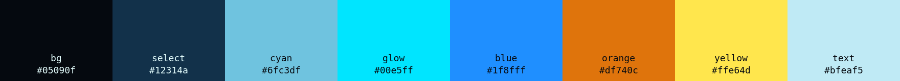
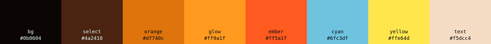
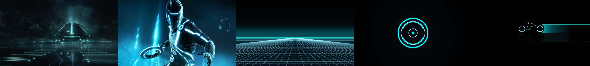
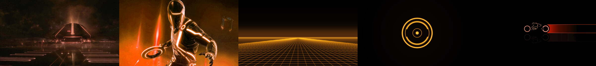
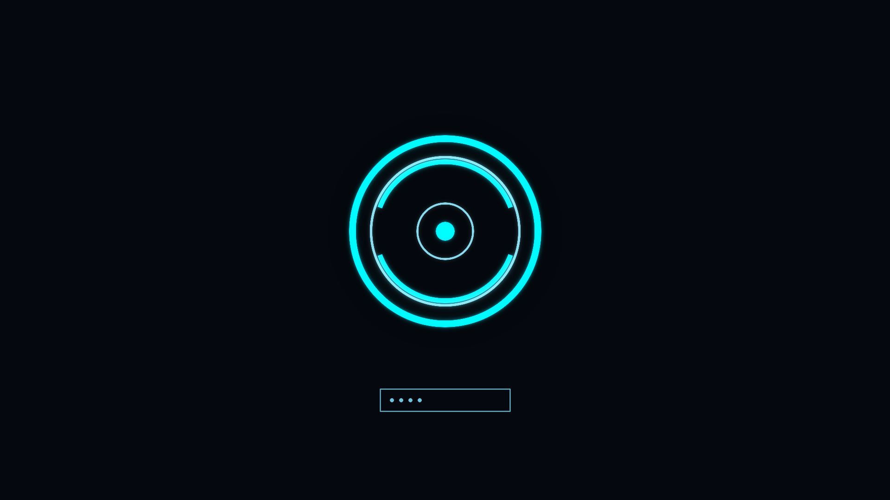
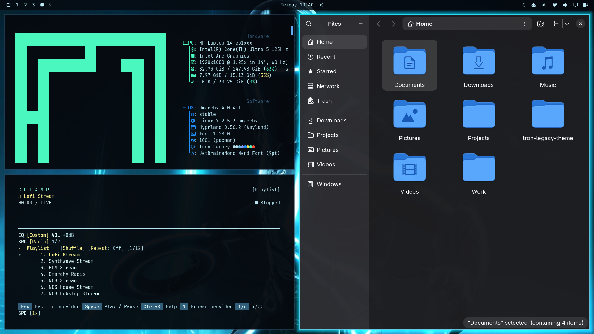
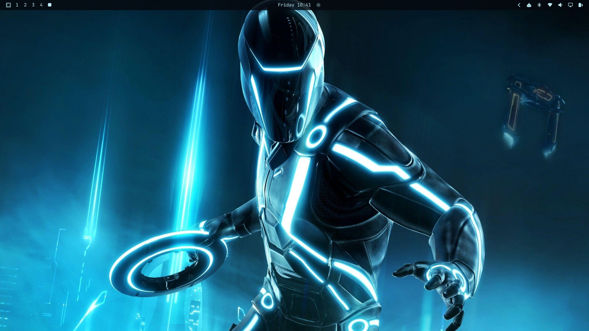

# Tron Legacy — Omarchy Theme

An [Omarchy](https://omarchy.org) theme inspired by Tron Legacy: deep grid black,
program cyan, and CLU orange. It comes in two variants:

- **Tron Legacy**: cyan, like Flynn's programs.
- **Tron Legacy CLU**: orange, like CLU and Rinzler.


## Palette




## Wallpapers




Four film stills, a light cycle, and two minimal wallpapers (neon grid and
identity disc). The CLU variant ships orange versions of all seven.

## Install

From git:

```bash
omarchy-theme-install https://github.com/ramaanindyaa/omarchy-tron-legacy-theme.git
```

From a local clone (every file is active, including Neovim, VS Code, and
Hyprland):

```bash
git clone https://github.com/ramaanindyaa/omarchy-tron-legacy-theme.git ~/tron-legacy-theme
ln -s ~/tron-legacy-theme ~/.config/omarchy/themes/tron-legacy
ln -s ~/tron-legacy-theme/variants/tron-legacy-clu ~/.config/omarchy/themes/tron-legacy-clu

omarchy-theme-set tron-legacy        # or: tron-legacy-clu
```

> Omarchy does not load `.lua` files, terminal configs, or `vscode.json` from
> themes installed with `omarchy-theme-install`. That means `hyprland.lua` and
> `neovim.lua` only take effect with the local symlink install. The base colors
> still apply from `colors.toml`. The CLU variant is only available through the
> symlink install.

### Boot / disk unlock screen (optional, needs sudo)

```bash
omarchy-plymouth-set-by-theme tron-legacy
```



## What's inside

| File | Purpose |
|---|---|
| `colors.toml` | Main palette; source for terminal, Chromium, keyboard colors, etc. |
| `hyprland.lua` | Cyan gradient borders with a glow on the active window |
| `shell.*.toml` | Translucent bar; menu, launcher, and notifications with cyan highlights; lock screen goes from cyan to orange on a wrong password |
| `neovim.lua` | tokyonight re-lit in Tron colors: cyan keywords, amber strings, orange numbers |
| `vscode-theme.json` | VS Code theme with Tron syntax colors |
| `btop.theme` | Cyan → orange graphs |
| `chromium.theme`, `keyboard.rgb`, `icons.theme` | Browser toolbar, keyboard backlight, blue Yaru icons |
| `unlock.png` | Identity disc logo for Plymouth |
| `variants/tron-legacy-clu/` | Orange CLU variant |

## Screenshots




## Credits

The film wallpapers are stills and fan art from *Tron: Legacy* (© Disney). The
grid and identity disc wallpapers were generated for this theme.
